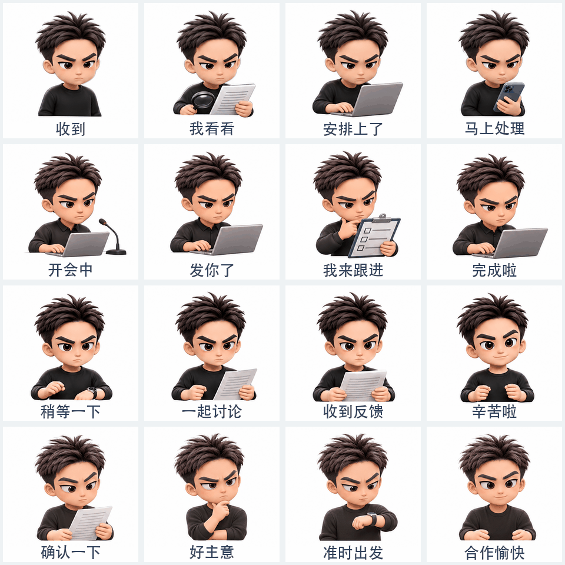

# 🎨 Vane GPT Image Skills

**GPT Image 2.6 好玩又能用的开源玩法合集，持续更新**

🏠 [作者个人主页 · Vane Studio](https://vane-creative-portfolio.krismile-7.chatgpt.site/)

这里收集可以直接上手的 AI 生图 Skill。每个玩法都有自己的效果展示和使用说明，从角色表情包开始，以后也会逐步收录封面、配图和其他创意玩法。

> 目前已收录 **1 个 Skill**。选择感兴趣的玩法，先看效果，再跟着教程开始制作。

## 📚 Skill 合集

### 🎭 角色与表情包

#### [照片转动态表情包](docs/portrait-gif-stickers.md)

上传人物照片、宠物照片或已有角色，选择喜欢的画风和聊天主题，让专属形象用表情和动作说话。

**12 种画风** · **6 个主题** · **默认一套 16 张**

**工作主题 · 16 格动态预览**

<a href="docs/portrait-gif-stickers.md"></a>

👉 **[查看全部 12 种画风、6 个主题与使用教程](docs/portrait-gif-stickers.md)**

## 🚀 开始使用

每个 Skill 的安装与使用方法可能不同，请打开对应教程查看。当前收录的动态表情包 Skill，可以在支持 Skill 的 Codex 环境中安装：

```bash
mkdir -p ~/.codex/skills
git clone https://github.com/VaneAi888/vane-gpt-image-skills.git ~/.codex/skills/vane-portrait-gif-stickers
```

开始新对话后，上传照片或已有角色，输入 `$vane-portrait-gif-stickers`，并告诉它想要的画风和主题。可以先要求查看角色和动作小样，再继续制作完整系列。

使用前请确认环境支持读取参考图和图像生成；动态 GIF 的效果取决于可用工具与素材，具体要求见[动态表情包教程](docs/portrait-gif-stickers.md)。

## ✨ 持续更新

未来计划按用途整理更多生图玩法，例如封面与社交媒体、文章与知识配图、照片与生活创意，以及趣味视觉实验。新 Skill 完成并具备使用说明后，会加入对应分区。

## 👋 关于作者

我是 **韦恩 Vane**，一名关注 AI 创作与品牌视觉设计的设计师。我分享 AI 工具、视觉创意和实用工作流，也会把有趣的实践整理成开源 Skill。

欢迎到 [Vane Studio 个人主页](https://vane-creative-portfolio.krismile-7.chatgpt.site/) 了解我的作品与创作方向。

## 📄 许可证

项目代码采用 [MIT License](LICENSE)。示例中涉及的第三方角色仅用于非官方风格演示；使用照片或角色素材时，请确认自己有相应使用权。
