# 🎨 Vane GPT Image Skills

**GPT Image 2.6 好玩又能用的开源玩法合集，持续更新**

𝕏 [关注我的 X 主页 · @VaneAILab](https://x.com/VaneAILab)

这里收集可以直接上手的 AI 生图 Skill。每个玩法都有自己的效果展示和使用说明，从角色表情包开始，以后也会逐步收录封面、配图和其他创意玩法。

> 目前已收录 **3 个 Skill**。选择感兴趣的玩法，先看效果，再跟着教程开始制作。

## 📚 Skill 合集

### 🎭 角色与表情包

#### [照片转动态表情包](docs/portrait-gif-stickers.md)

上传人物照片、宠物照片或已有角色，选择喜欢的画风和聊天主题，让专属形象用表情和动作说话。

**12 种画风** · **6 个主题** · **默认一套 16 张**

**12 种画风 · 12 组动态演示**

下面展示 4 种画风，每组包含 4 个动作小样。点击动图可放大查看。

| **Q 版萌系** | **手绘涂鸦风** |
| :---: | :---: |
| [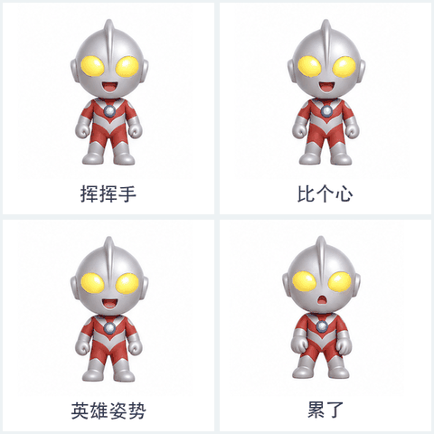](previews/style-01-chibi.gif) | [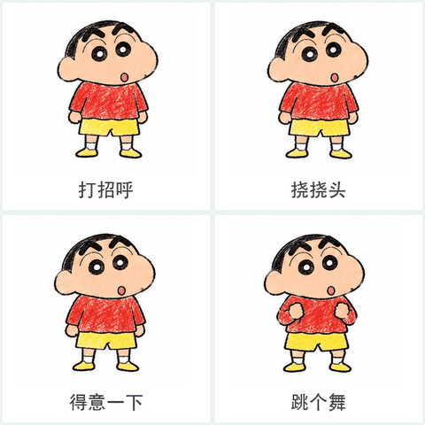](previews/style-06-doodle.gif) |
| **毛绒布偶风** | **复古漫画风** |
| [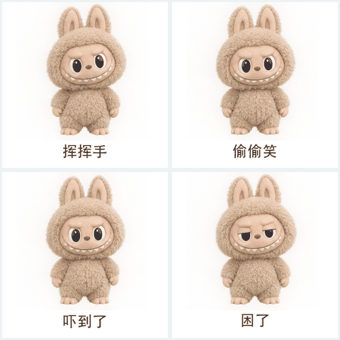](previews/style-09-plush.gif) | [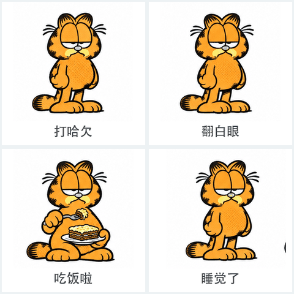](previews/style-12-comic.gif) |

👉 **[查看全部 12 种画风、6 个主题与使用教程](docs/portrait-gif-stickers.md)**

### 🎬 电影海报与视觉设计

#### [电影级海报设计](docs/vane-cinematic-poster.md)

根据影片故事和素材，选择构图、设计文字层级，制作中文或英文电影海报方案、提示词或实际图片。

**36 种版式** · **中英文各 4 组预览** · **默认竖版 2:3**

**中文海报预览**

| **01—09 · 人物主导** | **10—18 · 字体主导** |
| :---: | :---: |
| [](skills/vane-cinematic-poster/assets/poster-layouts-zh-01-09.png) | [](skills/vane-cinematic-poster/assets/poster-layouts-zh-10-18.png) |
| **19—27 · 场景与空间** | **28—36 · 概念与图形** |
| [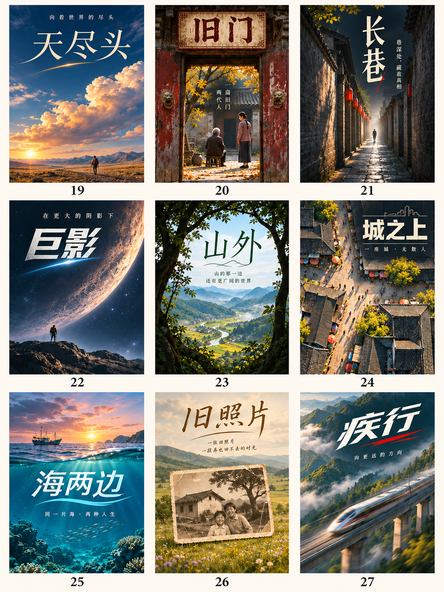](skills/vane-cinematic-poster/assets/poster-layouts-zh-19-27.png) | [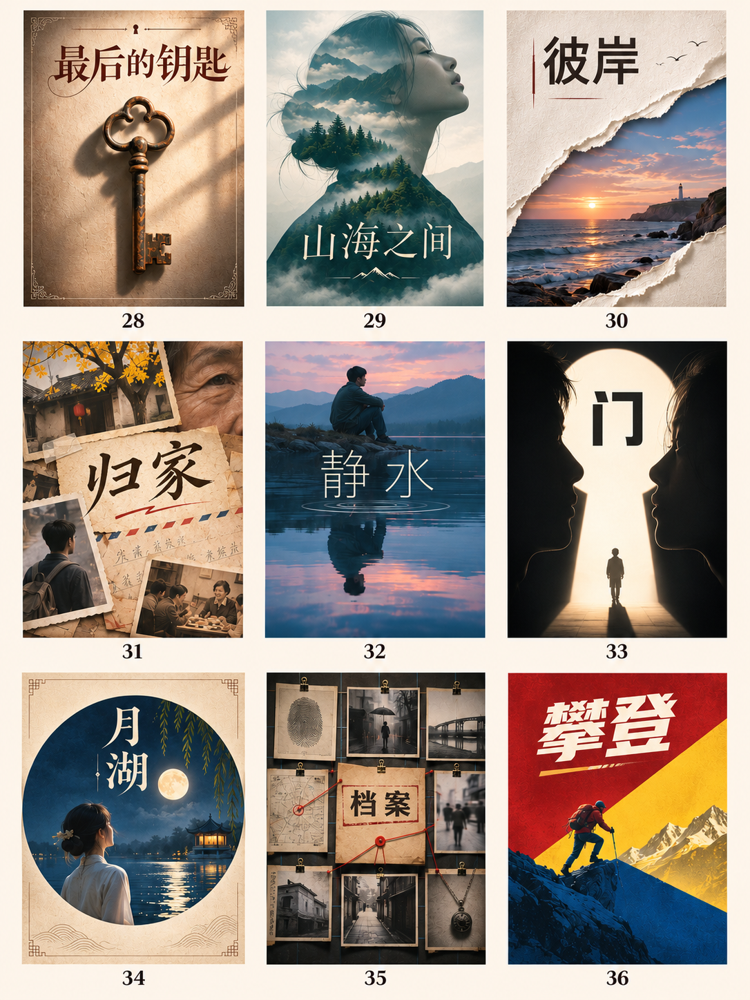](skills/vane-cinematic-poster/assets/poster-layouts-zh-28-36.png) |

**英文海报预览**

| **01—09 · 人物主导** | **10—18 · 字体主导** |
| :---: | :---: |
| [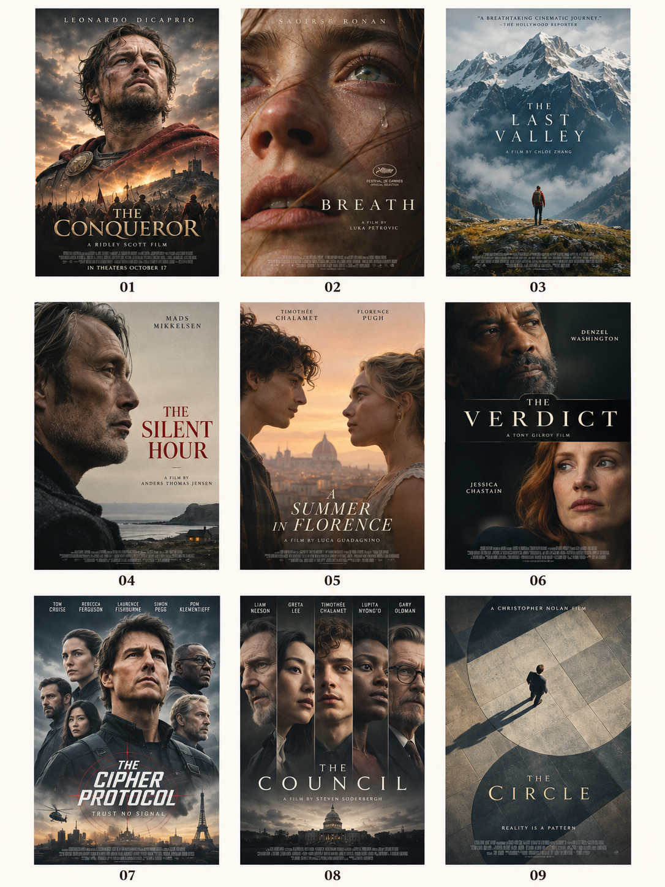](skills/vane-cinematic-poster/assets/poster-layouts-01-09.png) | [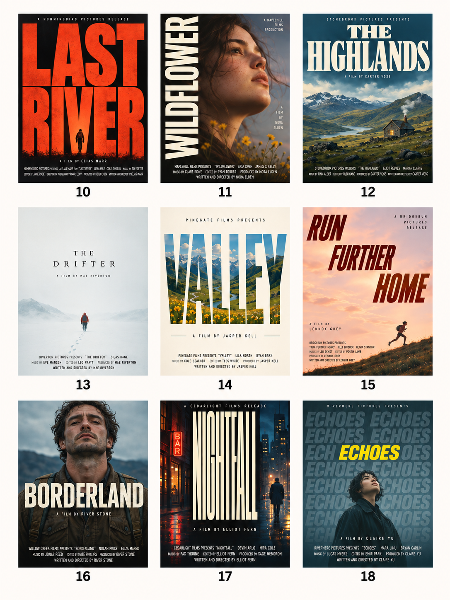](skills/vane-cinematic-poster/assets/poster-layouts-10-18.png) |
| **19—27 · 场景与空间** | **28—36 · 概念与图形** |
| [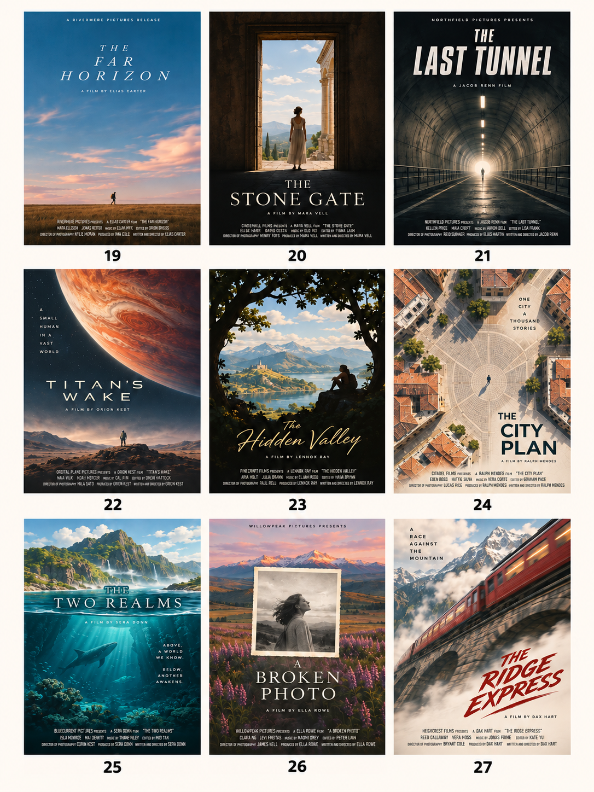](skills/vane-cinematic-poster/assets/poster-layouts-19-27.png) | [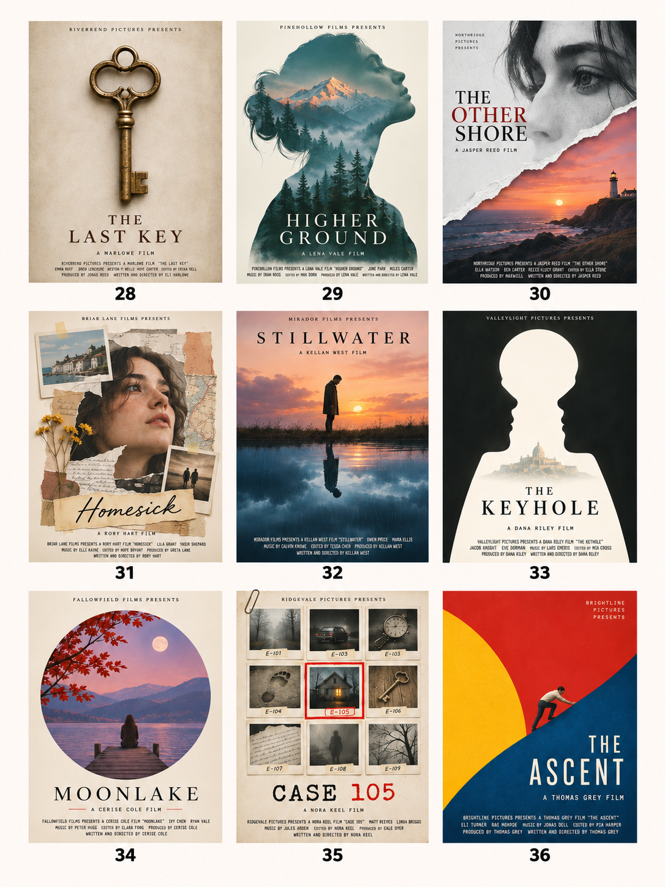](skills/vane-cinematic-poster/assets/poster-layouts-28-36.png) |

中英文预览分别设计，并非逐字翻译。图片为构图示例，其中的人物姓名、片方及荣誉文字不代表真实影片信息或授权背书。

👉 **[查看 36 种版式介绍与完整使用教程](docs/vane-cinematic-poster.md)**

#### [书页里的电影](docs/vane-book-cinema.md)

从书中的人物、故事或意象出发，把阅读时的想象变成电影感海报。小说和非虚构作品都可以尝试。

**36 本书籍效果示例** · **4 组完整预览** · **默认竖版 2:3**

| **01—09** | **10—18** |
| :---: | :---: |
| [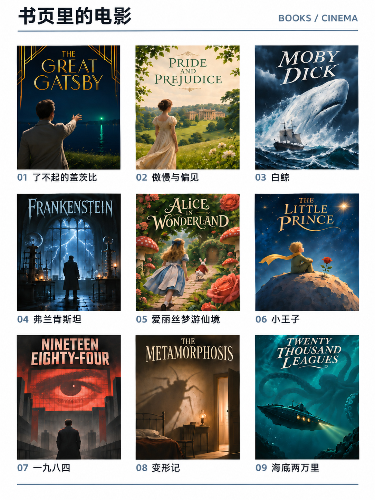](skills/vane-book-cinema/assets/books-01-09.jpg) | [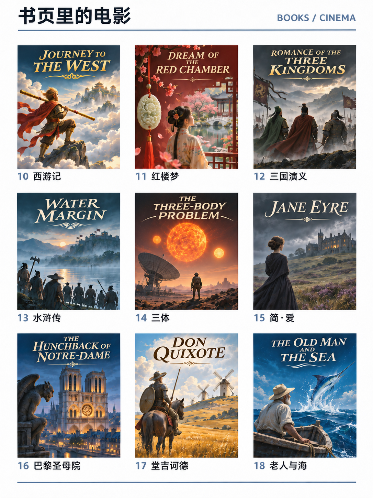](skills/vane-book-cinema/assets/books-10-18.jpg) |
| **19—27** | **28—36** |
| [](skills/vane-book-cinema/assets/books-19-27.jpg) | [](skills/vane-book-cinema/assets/books-28-36.jpg) |

以上是书籍海报的创意展示，非官方改编或授权海报。

👉 **[查看全部书籍示例与使用教程](docs/vane-book-cinema.md)**

## 🚀 开始使用

先克隆合集，再选择安装单个或全部 Skill：

```bash
git clone https://github.com/VaneAi888/vane-gpt-image-skills.git
cd vane-gpt-image-skills
python3 scripts/install_skills.py --all
```

安装器不会覆盖已存在的同名 Skill。如果只想安装其中一个，请查看统一安装教程。安装完成后开启新的 Codex 对话，用 `$vane-portrait-gif-stickers`、`$vane-cinematic-poster` 或 `$vane-book-cinema` 调用。

👉 **[统一安装教程](docs/installation.md)** · **[效果与安装测试记录](docs/testing.md)**

使用前请确认环境支持读取参考图和图像生成；GIF 动作、图片文字和透明背景的效果取决于实际素材与可用工具。

## ✨ 持续更新

未来计划按用途整理更多生图玩法，例如封面与社交媒体、文章与知识配图、照片与生活创意，以及趣味视觉实验。新 Skill 完成并具备使用说明后，会加入对应分区。

## 👋 关于作者

我是 **韦恩 Vane**，一名关注 AI 创作与品牌视觉设计的设计师。我分享 AI 工具、视觉创意和实用工作流，也会把有趣的实践整理成开源 Skill。

欢迎关注我的 [X 主页 @VaneAILab](https://x.com/VaneAILab)，一起交流 AI 工具与创作玩法。

## 📄 许可证

项目代码采用 [MIT License](LICENSE)。示例中涉及的第三方角色仅用于非官方风格演示；使用照片或角色素材时，请确认自己有相应使用权。
