# 🎭 照片转动态表情包

[← 返回 Skill 合集首页](../README.md)

上传照片或已有角色，选一种喜欢的画风和聊天主题，让你的专属形象做出表情和动作，变成可循环的 GIF 表情包。

**12 种画风 · 6 个主题 · 默认一套 16 张**

> 从人物照片到动物、卡通与现有 IP，都可以按素材特点选择画风。用户提供现成角色时，默认保留原有造型与画风；也可以指定转换。

## ✨ 它能做什么

- **角色自己动起来**：设计表情、手势和身体动作，而不是只让整张图片摇摆。
- **选择你喜欢的画风**：Q 版、像素、手绘、3D、水墨等 12 种方向，也支持自定义。
- **画风与主题自由组合**：例如“像素风 × 情绪现场”或“毛绒风 × 鼓励搭子”。
- **先看小样，再制作一整套**：检查角色辨识度、动作、循环和画面位置。
- **交付方便使用**：默认每张 320 × 320、约 2 秒循环，支持透明 GIF、预览和打包；以实际生成结果为准。

## 🎨 12 种画风，12 组动态演示

每组展示 **4 个动作小样**。示例中的真人为 AI 生成的虚拟人物；角色案例是非官方的风格演示，并非品牌合作或授权声明。画面使用少量关键帧，部分动作可能有跳动。**点击任意动图可放大查看**，手机上也可以单独打开。

| **01 · Q 版萌系**<br>圆润造型，动作活泼 | **02 · 真人实拍风**<br>自然人物比例与摄影质感 |
| :---: | :---: |
| [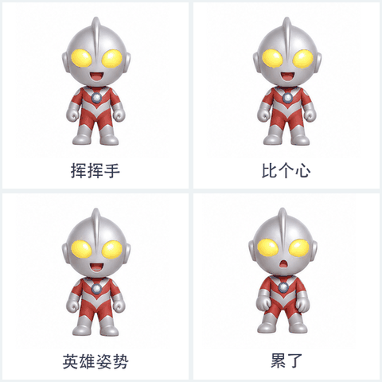](../previews/style-01-chibi.gif) | [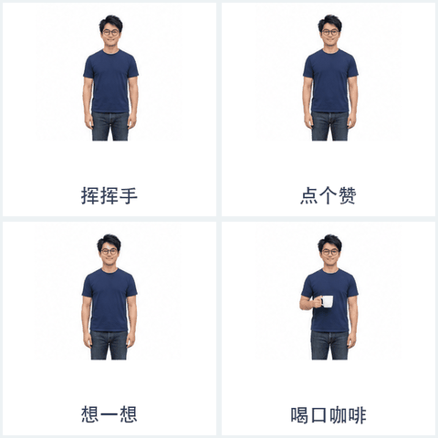](../previews/style-02-realistic.gif) |
| **03 · 像素风**<br>清晰方块与像素边缘 | **04 · 日漫二次元**<br>简洁线条与动漫表情 |
| [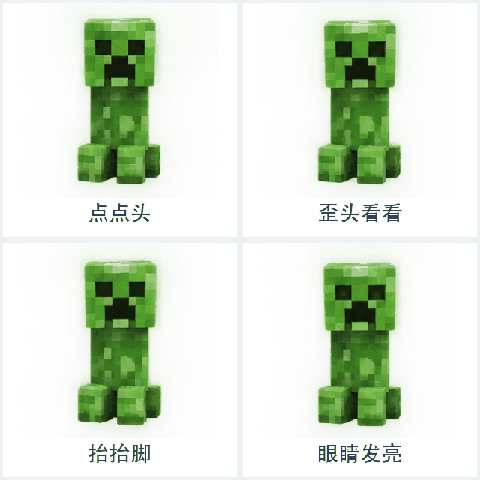](../previews/style-03-pixel.gif) | [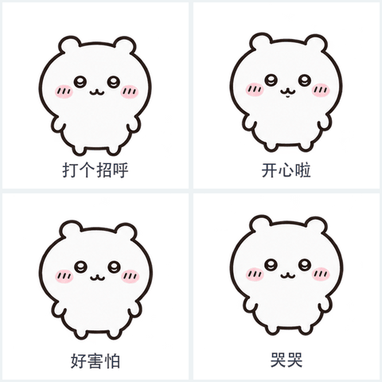](../previews/style-04-anime.gif) |
| **05 · 3D 立体风**<br>圆润造型与立体光影 | **06 · 手绘涂鸦风**<br>手绘笔触与轻松表情 |
| [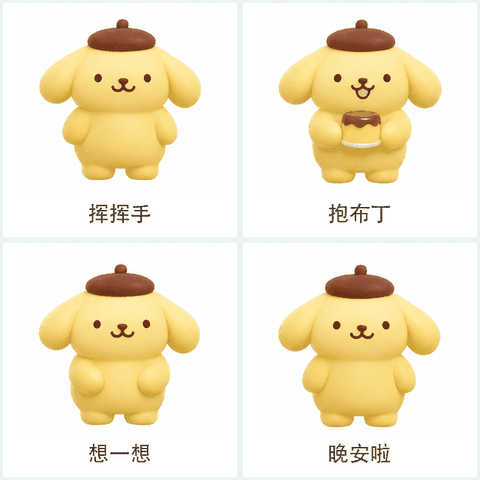](../previews/style-05-3d.gif) | [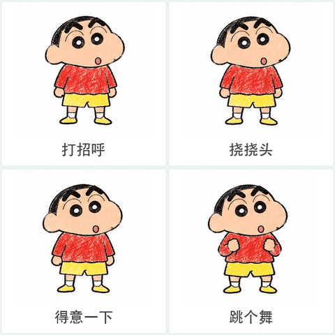](../previews/style-06-doodle.gif) |
| **07 · 扁平矢量风**<br>简洁轮廓与平面色块 | **08 · 极简线稿风**<br>少量线条也能表达情绪 |
| [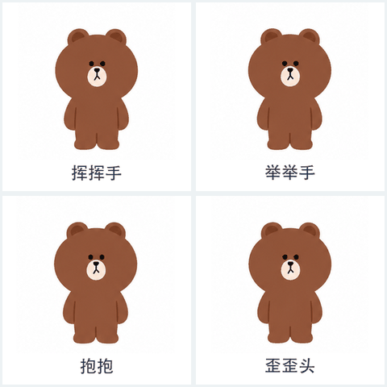](../previews/style-07-flat.gif) | [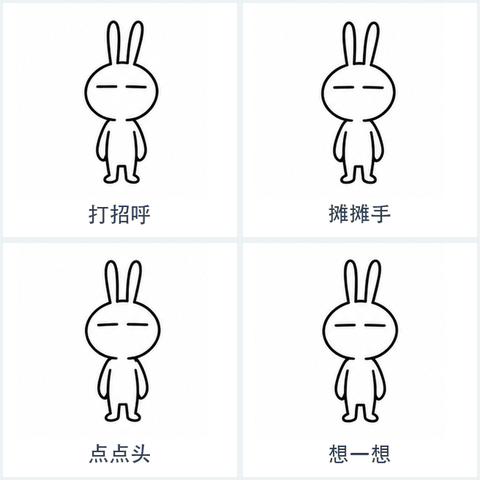](../previews/style-08-line.gif) |
| **09 · 毛绒布偶风**<br>柔软绒毛与玩偶质感 | **10 · 拼贴剪纸风**<br>纸张纹理与层叠造型 |
| [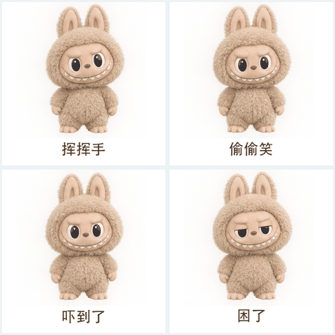](../previews/style-09-plush.gif) | [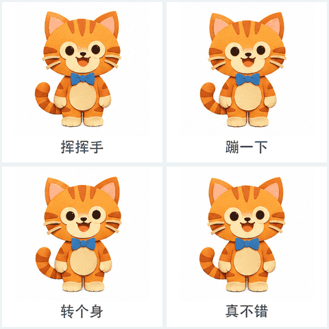](../previews/style-10-papercut.gif) |
| **11 · 国风水墨风**<br>水墨笔触与中国风造型 | **12 · 复古漫画风**<br>漫画线条与复古印刷感 |
| [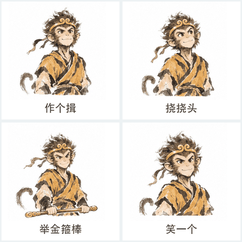](../previews/style-11-ink.gif) | [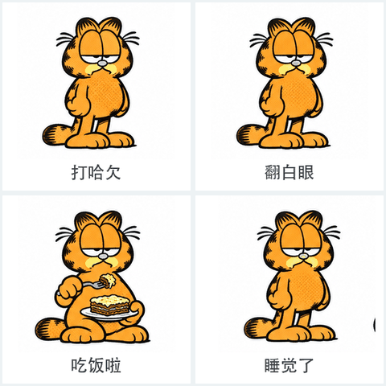](../previews/style-12-comic.gif) |

> 矢量风指视觉效果，GIF 本身不是可编辑的矢量文件。可以直接指定上述画风，也可以上传参考图或描述自己的画风。

## 💬 6 个聊天主题

每个主题预览包含 **16 个动态示例**。点击下方标题展开；实际制作时会根据你的角色重新设计，不受这些示例文案限制。

<details>
<summary><strong>01 · 工作中</strong> — 收到、我看看、安排上了</summary>

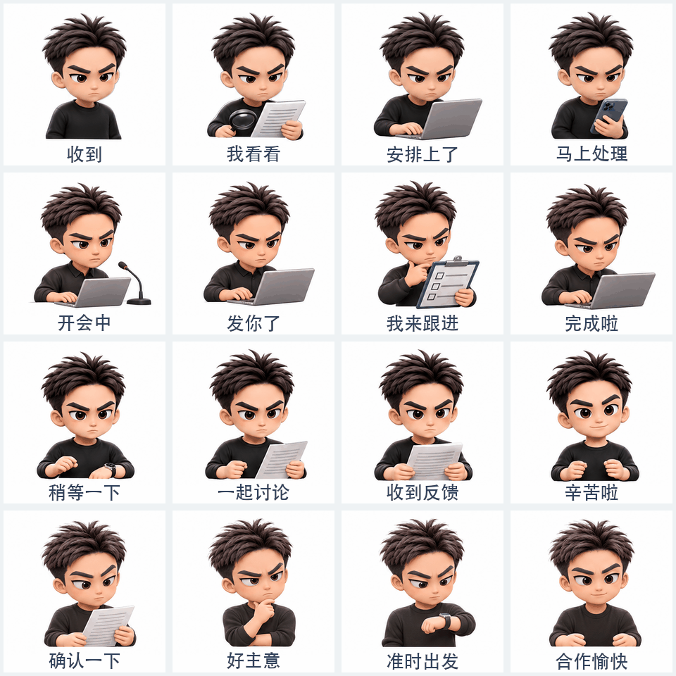

</details>

<details>
<summary><strong>02 · AI 搭子</strong> — 问问 AI、灵感来了、生成中</summary>


</details>

<details>
<summary><strong>03 · 情绪现场</strong> — 震惊了、笑不活了、人麻了</summary>

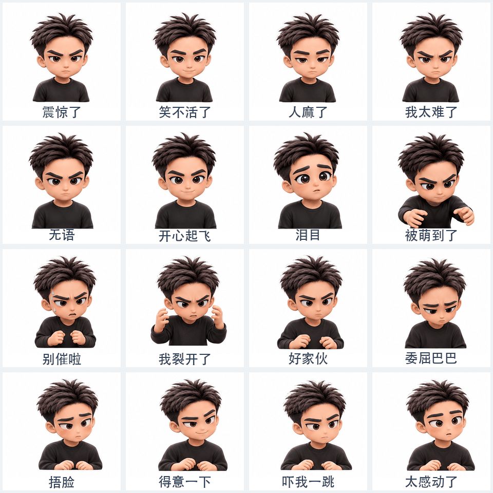

</details>

<details>
<summary><strong>04 · 鼓励搭子</strong> — 陪着你、为你鼓掌、你可以的</summary>

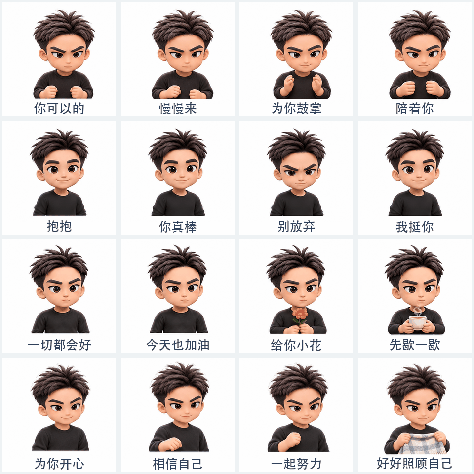

</details>

<details>
<summary><strong>05 · 摸鱼日常</strong> — 喝口咖啡、先歇一下、下班啦</summary>

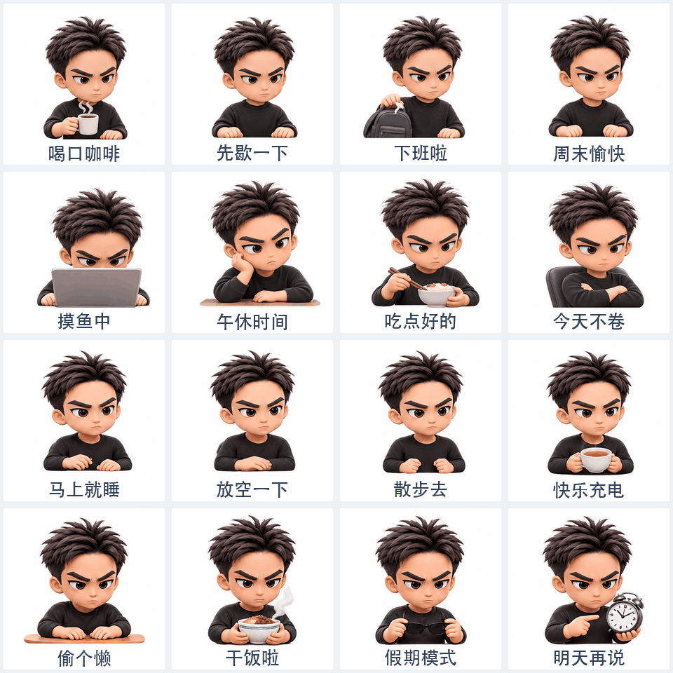

</details>

<details>
<summary><strong>06 · 节日限定</strong> — 恭喜发财、生日快乐、节日快乐</summary>


</details>

## 🚀 开始使用

**1. 安装 Skill**

在支持 Skill 的 Codex 环境中，将仓库克隆到技能目录：

```bash
mkdir -p ~/.codex/skills
git clone https://github.com/VaneAi888/vane-gpt-image-skills.git ~/.codex/skills/vane-portrait-gif-stickers
```

**2. 上传照片或已有角色，告诉它画风和主题**

例如：

> 使用 $vane-portrait-gif-stickers，根据这张照片做像素风角色，再制作“情绪现场”动态表情包。先给我看角色和动作小样。

或者：

> 使用 $vane-portrait-gif-stickers，保留这只小猫的原有画风，制作 16 张“工作中”动态表情包。

**3. 确认角色与动作**

先看角色参考和少量动作小样，再按需要生成完整系列。没有指定画风时，人物照片可从 Q 版开始；已有角色默认保留原画风。

**4. 预览并导出**

可获得单张 GIF、合集压缩包及预览。生成质量、透明背景与动作流畅度取决于参考素材和可用工具；请在目标平台检查尺寸与显示效果。

## 🛠️ 运行环境与说明

- 支持图像生成并能读取本地参考图的 AI 助手；人物动作可根据条件选择连续帧、视频或分层动画制作。
- Python 3 和 Pillow；生成 MP4 预览需要 FFmpeg，以及覆盖文案的本地字体。
- [连续动作帧与像素风导出说明](../references/frame-manifest.md) · [旧版整图动画说明](../references/manifest.md)
- 请使用自己提供或有权使用的照片与角色素材。公开发布其他 IP 的演示前，请核对相应素材的使用权；个人照片和角色参考默认不包含在分享包中。

## 许可证

项目代码采用 [MIT License](../LICENSE)。导出器中的第三方代码版权和许可声明见 [许可证文件](../references/third-party-LICENSE)。
