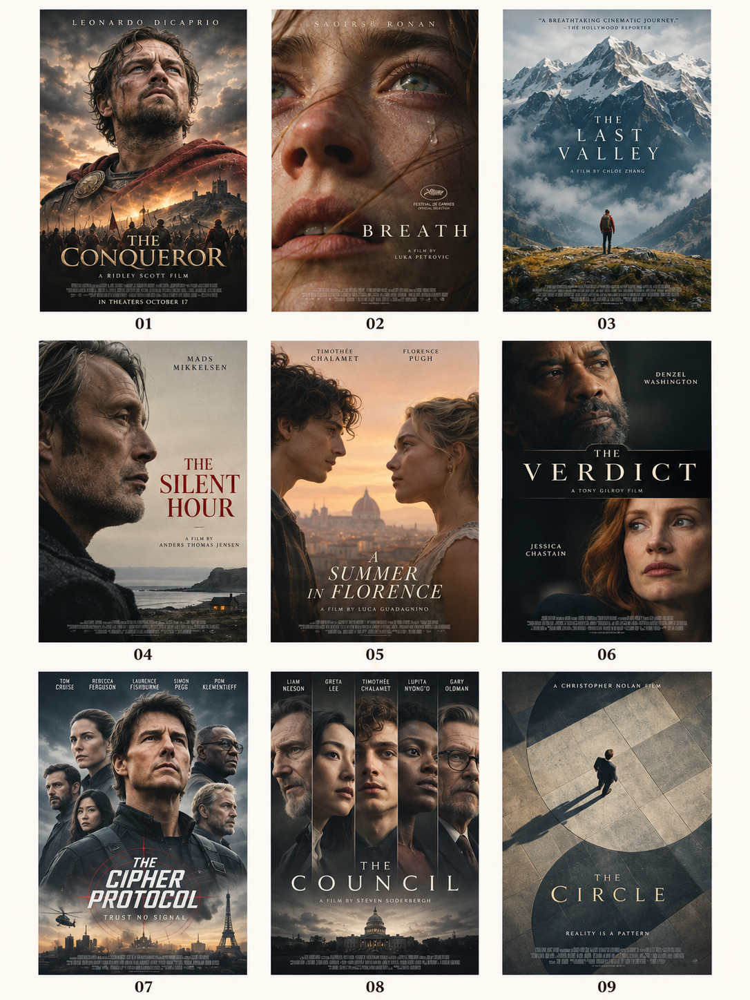
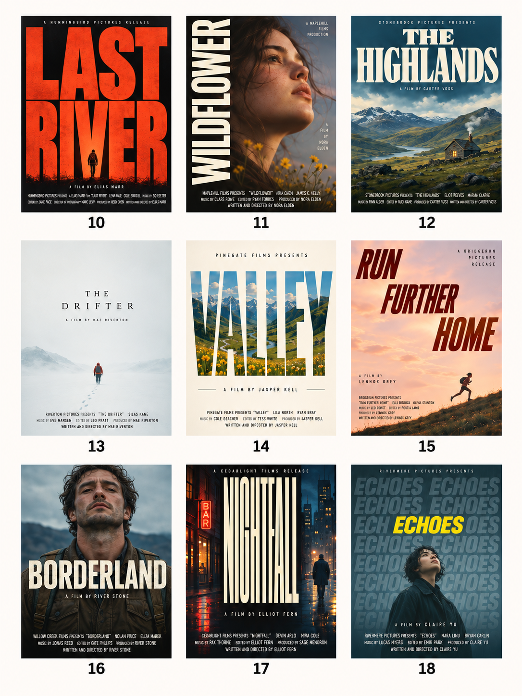
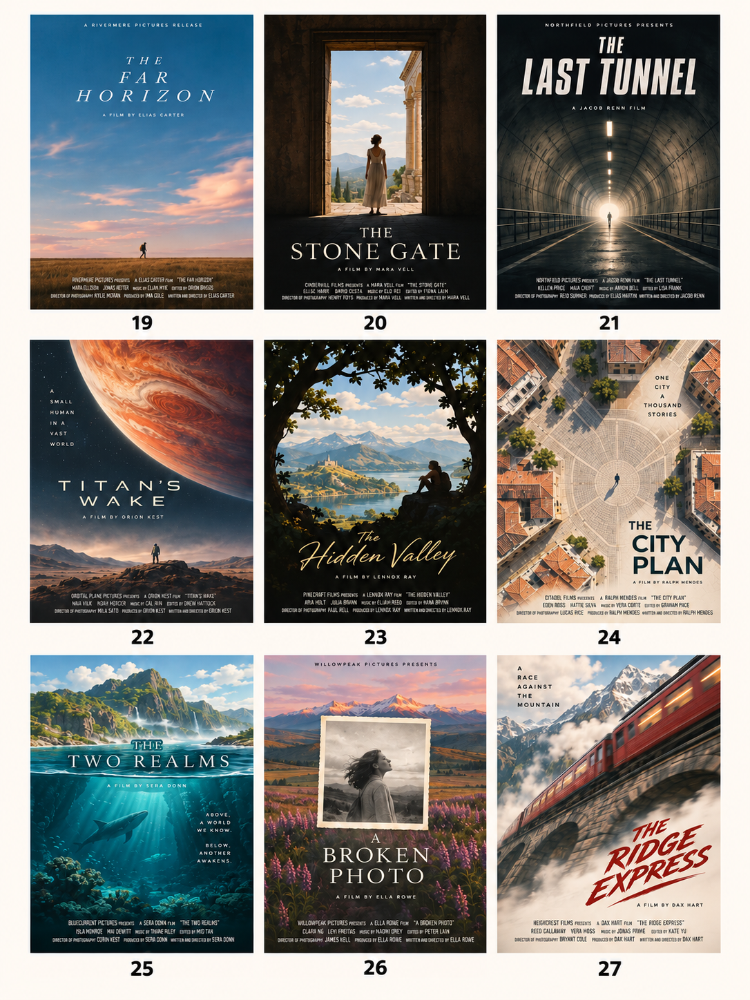
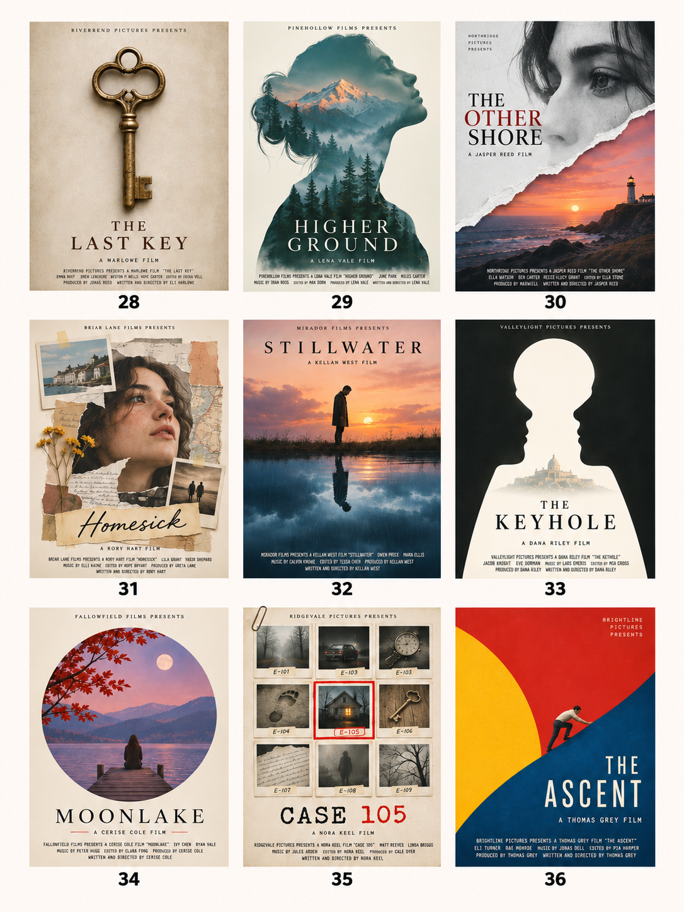

# 🎬 电影级海报设计

[← 返回 Skill 合集首页](../README.md)

根据影片类型、故事、人物和素材，选择电影海报的构图与文字排版，制作设计方案、生成提示词或实际海报。

**36 种版式** · **4 组完整预览** · **默认竖版 2:3**

## ✨ 适合做什么

- 为电影、短片、虚构影片或电影节项目寻找不同的海报构图。
- 根据故事和手头的素材推荐方向，也可以直接指定 01—36 的版式编号。
- 按需交付构图建议、提示词、实际图片或已有海报的修改方案。

## 🖼️ 完整效果展示

四张预览各包含 9 种版式，按编号覆盖全部 **01—36**。点击图片可查看原图。

| **01—09 · 人物主导** | **10—18 · 字体主导** |
| :---: | :---: |
|  |  |
| **19—27 · 场景与空间** | **28—36 · 概念与图形** |
|  |  |

> 预览图是构图和排版的创意示例。图中的人物、演员与主创姓名、片方及荣誉文字仅用于视觉展示，不代表真实影片信息、合作、授权或背书。正式使用前请核对文字和素材使用权。

## 🚀 开始使用

**1. 安装 Skill**

按照[统一安装教程](installation.md)获取合集，选择安装 `vane-cinematic-poster`；版式库和四张预览参考图会一并安装。

**2. 提供影片信息或素材**

可以提供片名、故事梗概、类型、情绪、人物或场景素材。用户没有确定版式时，Skill 会结合内容推荐；也可以直接指定编号。例如：

> 使用 $vane-cinematic-poster，为一部讲述独自穿越雪山的短片设计海报，片名是「……」。先推荐两种构图，并说明选择理由。

> 使用 $vane-cinematic-poster，按照 29 号「剪影双重曝光」版式制作竖版海报。参考我上传的人物照片和山林图片，片名用「……」。

**3. 检查文字与画面**

核对片名、人物、日期和其他文字，检查缩略图里的视觉焦点、标题可读性与裁切。生成工具无法准确绘字时，可以先生成无字画面，再后期排版。

## 🛠️ 运行环境与说明

- 需要支持 Skill 的环境；实际生成或修改图片时，还需要可用的图像生成／编辑工具。
- 默认提供竖版 2:3 的设计方向，也可以按用户指定的尺寸重新布局。
- 36 种编号是本 Skill 内部的沟通方式，不是行业标准或固定模板。
- 不同文字长度、语言和参考素材会影响成图；用户提供的真实片名及信息应原样保留。

## 🔍 效果测试与使用边界

四张预览图和版式库已检查，现有示例及其限制见[效果测试记录](testing.md)。本轮收录没有重新生成 36 张海报，图片中文字与实际海报仍需逐项核对。

## 📂 Skill 文件

- [Skill 指令](../skills/vane-cinematic-poster/SKILL.md)
- [36 种版式库](../skills/vane-cinematic-poster/references/layouts.md)
- [统一安装入口](installation.md)
