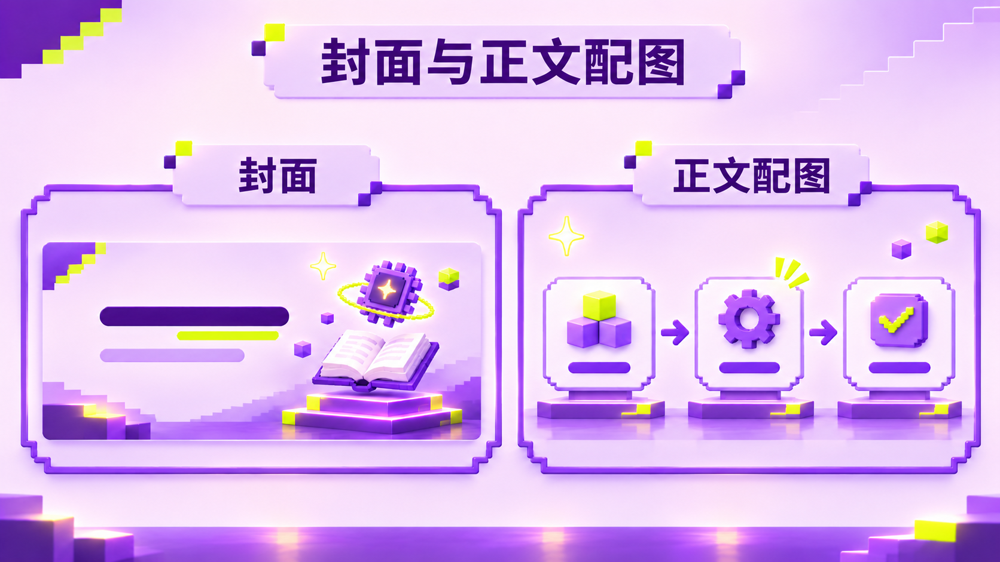
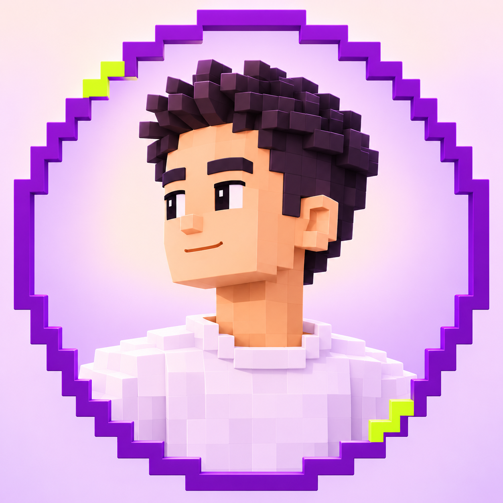

# 🟣 紫色像素风 · X 文章视觉

[← 返回 Skill 合集首页](../README.md)

用统一的紫色像素视觉，制作 X 文章封面与正文配图。整体以浅暖色和浅紫为底，搭配深紫阶梯边缘、3D 体素元素，以及少量荧光黄绿色点缀。

**文章封面** · **正文配图** · **紫色像素品牌风**

## ✨ 适合做什么

- 为 X 文章设计 5:2 横版封面，按主题调整标题层级和插画。
- 为文章制作流程、对比、场景等正文配图，默认使用统一的紫色像素视觉。
- 根据用户提供的参考图和要求选择是否加入角色，不强制使用 Vane 的形象。

## 🖼️ 效果展示

### X 文章封面

宽幅封面示例展示了标题层级、重点色块与主题插画。默认封面比例为 **5:2**，通常输出 **2000 × 800**；文字和右侧画面可按你的文章主题重新设计。

### 正文配图一 · 流程图

用像素风图标和箭头组织步骤，适合解释操作过程与创作流程。

### 正文配图二 · 内容对比

用并列构图呈现不同用途或不同方案，方便读者快速比较。

以上是静态示例。正文配图可根据内容选择流程、对比、场景、概念或网格等构图；示例文案不限定你的文章主题。

### 其他风格参考

<strong>查看 X 主页背景与像素角色参考</strong>

**X 主页背景**

**像素角色**

本 Skill 的参考素材与默认角色属于 Vane 的个人品牌视觉。需要制作自己的个人品牌时，请提供自己的形象、主题和风格要求；是否使用人物可自行指定。

## 🚀 开始使用

**1. 安装 Skill**

请按照[统一安装教程](installation.md)获取合集，再选择安装 `vane-pixel-visuals`。安装器会一并复制需要的参考素材。

**2. 提供文章内容和要求**

开始新对话后，可以这样使用：

> 使用 $vane-pixel-visuals，为我的 X 文章制作一张 5:2 紫色像素风封面。文章标题是「……」，重点突出「……」。

也可以这样制作正文配图：

> 使用 $vane-pixel-visuals，把下面的内容做成一张 16:9 的流程示意图。保持紫色像素视觉，文字简短、清晰。

**3. 检查并导出**

生成后检查标题、文字、比例及主题相关性；图像文字的准确度取决于所用的图像生成工具。

## 🛠️ 运行环境与说明

- 需要支持 Skill、读取参考图及图像生成的环境；安装时请保留 `assets` 目录。
- 本 Skill 的内置头像和画风为 Vane 的个人品牌参考，制作其他人的视觉时以用户自己的素材和要求为准。
- 封面默认 5:2；正文配图示例接近 16:9，可按目标平台调整。

## 🔍 效果测试与使用边界

封面、正文配图和 5 张参考素材的检查结果见[效果测试记录](testing.md)。生成图仍需人工核对文字、人物和版式。

## 📂 Skill 文件

- [Skill 指令](../skills/vane-pixel-visuals/SKILL.md)
- [参考素材说明](../skills/vane-pixel-visuals/assets/README.md)
- [动态表情包 Skill](portrait-gif-stickers.md)
