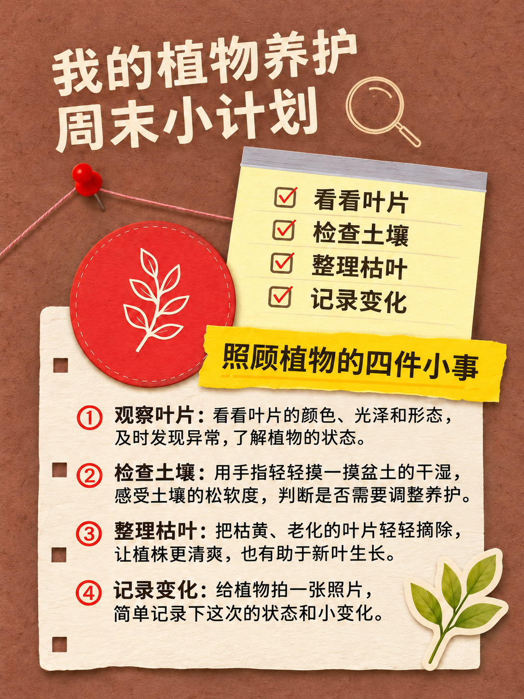
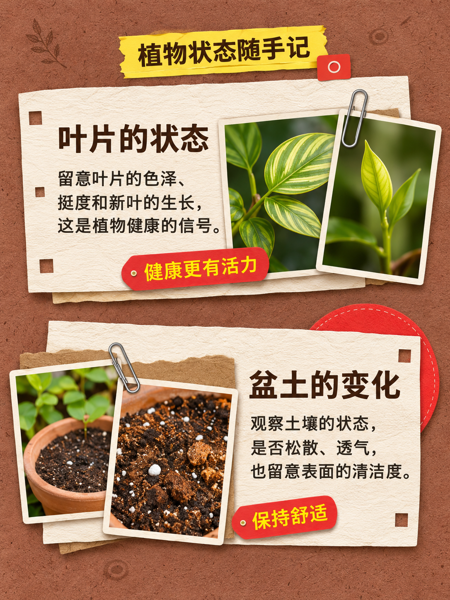
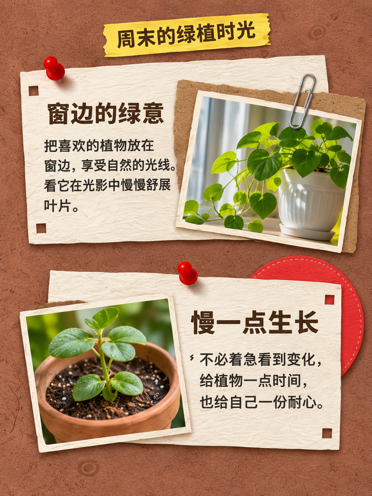
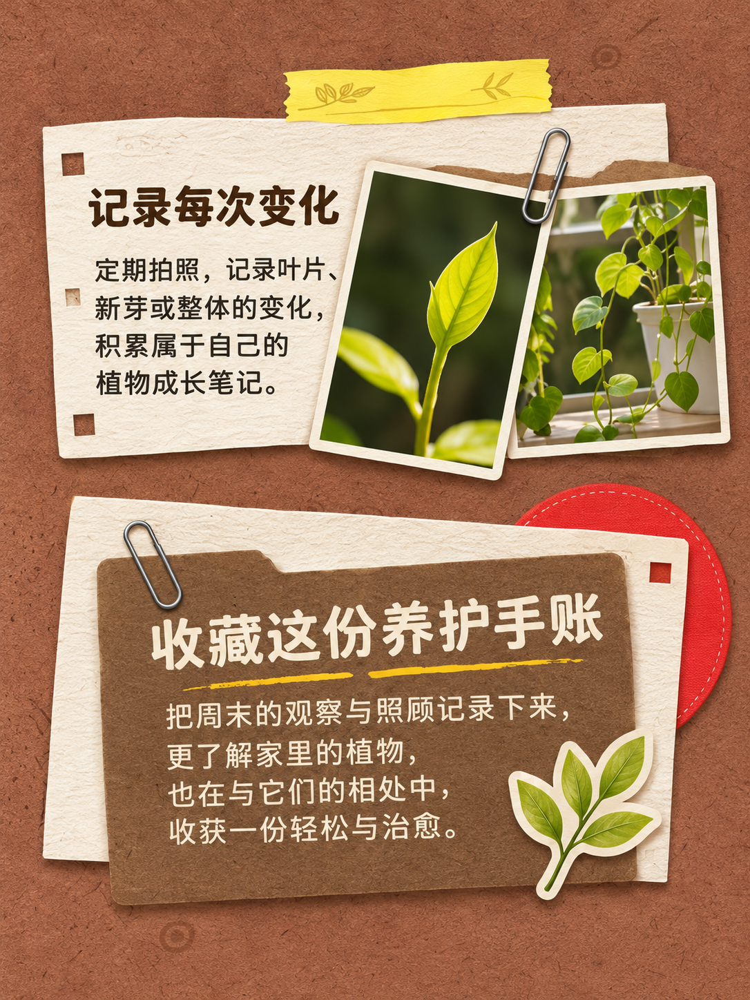

# 📕 Vane 小红书图文设计

[← 返回 Skill 合集首页](../README.md)

把文字和图片制作成小红书封面与正文图，按内容选择合适的视觉风格。一个 Skill 持续收录不同风格，目前已收录 **手帐拼贴风**。

**已收录 1 种风格** · **封面与正文图** · **更多风格持续更新**

## 🎨 选择风格

| 风格 | 适合内容 | 效果展示 |
| --- | --- | --- |
| 手帐拼贴风 | 生活记录、兴趣分享、旅行、探店、好物和轻量干货 | [查看九页效果](#手帐拼贴风) |

## 手帐拼贴风

棕色纸张、米白便签、照片、标签与图钉组成一套有手帐感的图文。默认设计 **封面、7 张内页和结尾，共 9 页**，每页版式各有变化。

### 🖼️ 完整效果展示

以下是同一主题的九页示例。点击图片可查看原图；首页展示了其中前四张。

| **01 · 封面** | **02 · 养护计划** |
| :---: | :---: |
|  |  |
| **03 · 叶片与土壤** | **04 · 植物拼贴** |
|  |  |
| **05 · 阳光与观察** | **06 · 叶片与盆土** |
|  |  |
| **07 · 植物观察清单** | **08 · 绿植时光** |
|  |  |

**09 · 结尾收藏**

[查看九宫格整体预览](../previews/xhs-scrapbook/overview-grid.png)

这些是展示样例，主题和文字会随用户提供的内容变化。九宫格用于预览，不等同于九张高清成品。

### 🚀 如何使用

按照[统一安装教程](installation.md)安装 `vane-xhs-design`，然后提供文字，并选择使用自己的图片或 AI 示意配图。例如：

> 使用 $vane-xhs-design 的手帐拼贴风，把下面的文字做成一套小红书图文。我选择文字加 AI 配图，请先给我看九宫格预览和每页文案：……

也可以提供照片、截图或产品图，并说明它们在图文中的用途。Skill 会先规划内容与九宫格预览；确认预览和逐页文案后，再逐张生成独立图片。

## 🛠️ 使用说明

- 需要支持读取参考图的图像生成或编辑工具；用户图片会按实际用途作为参考。
- 手帐拼贴风默认 9 页、每页竖版 3:4。生成效果、中文文字和实际尺寸需逐页核对。
- AI 配图是示意，不应冒充真实店铺、产品或个人经历。Skill 不会自动发布到小红书。
- 后续新风格会加入同一个 Skill，已安装用户可按[统一更新教程](updating.md)获取。

## 🔍 效果测试与使用边界

本次收录检查了九页样例、九宫格预览与安装文件，具体情况见[效果测试记录](testing.md)。本次没有重新生成完整图文，实际生成结果依赖所用工具和素材。

## 📂 Skill 文件

- [Skill 入口](../skills/vane-xhs-design/SKILL.md)
- [手帐拼贴风制作指南](../skills/vane-xhs-design/styles/scrapbook/STYLE.md)
- [统一安装入口](installation.md)
