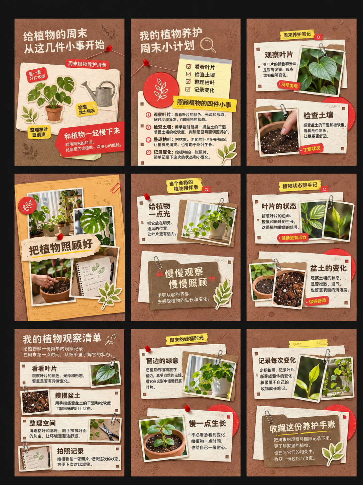
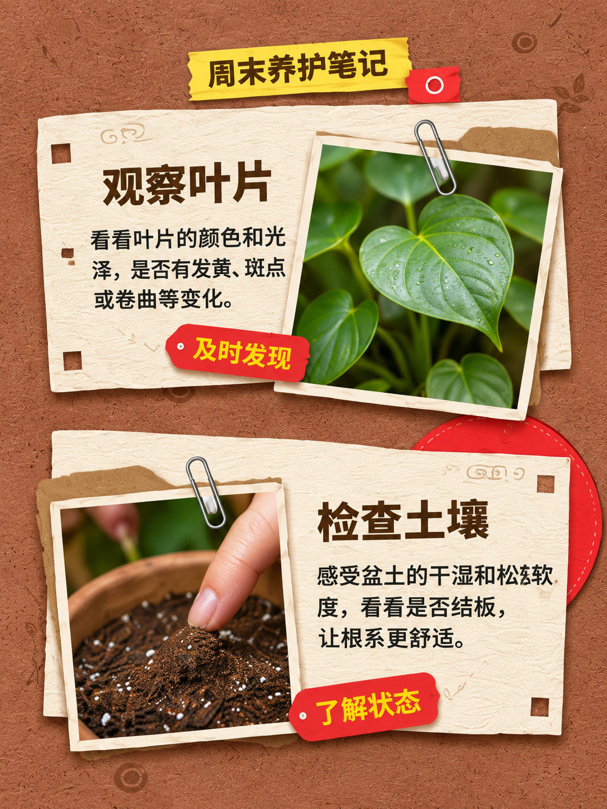
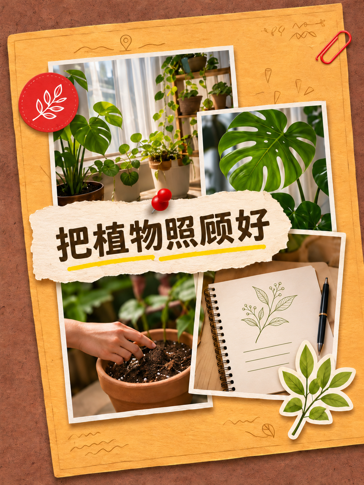
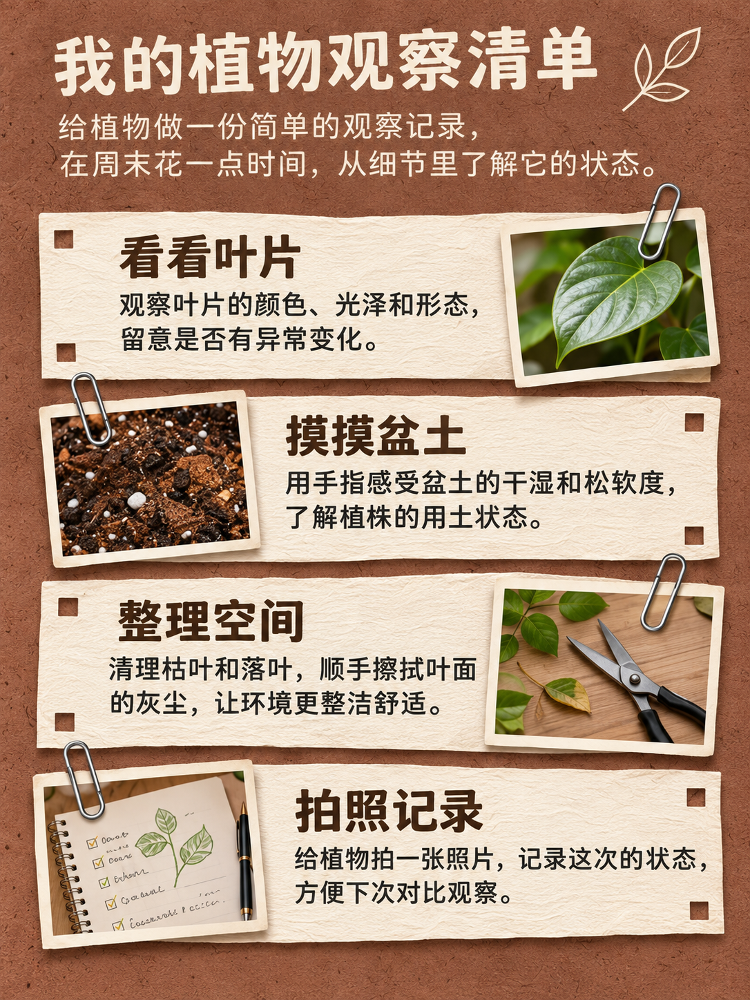

# 📕 Vane 小红书图文设计

[← 返回 Skill 合集首页](../README.md)

把文字和图片制作成小红书封面与正文图，选择喜欢的视觉风格。一个 Skill 持续收录不同风格，目前有 **手帐拼贴风、极简产品风**。

**2 种风格** · **封面与正文图** · **更多风格持续更新**

## 🎨 选择风格

先看看两种风格的整体效果；点击九宫格可以查看原图，也可以向下展开查看每张单页。

| **手帐拼贴风** | **极简产品风** |
| :---: | :---: |
|  |  |
| 纸张、照片与便签拼贴，适合生活记录、兴趣分享和轻量干货。 | 白底、留白与统一主体，适合产品、AI 工具和生活方式内容。 |
| [查看 9 张单页](#手帐拼贴风) | [查看 9 张单页](#极简产品风) |

九宫格用于预览，不能直接当作九张高清成品。极简产品风中的产品名称与画面仅为图文设计示例，不代表官方合作或授权。

## 🚀 开始使用

1. 按照[统一安装教程](installation.md)安装 `vane-xhs-design`。
2. 提供文字，选择手帐拼贴风或极简产品风；配图可使用自己的照片、截图、产品图，或选择 AI 示意配图。
3. 先查看九宫格预览和逐页文案；确认后再逐张生成独立图片。

可以直接复制下面的示例，将风格名称和内容换成自己的：

> 使用 $vane-xhs-design 的手帐拼贴风，把下面的文字做成一套小红书图文。我选择文字加 AI 配图，请先给我看九宫格预览和每页文案：……

> 使用 $vane-xhs-design 的极简产品风，把下面的文字做成一套小红书图文。我选择文字加我的产品图片，请先给我看九宫格预览和每页文案：……

## 🖼️ 查看完整单页

两种风格各有 9 张示例，点击对应标题展开；展开后点击图片可查看原图。

### 手帐拼贴风

<strong>展开查看手帐拼贴风的 9 张单页</strong>

| **01 · 封面** | **02 · 养护计划** |
| :---: | :---: |
|  |  |
| **03 · 叶片与土壤** | **04 · 植物拼贴** |
|  |  |
| **05 · 阳光与观察** | **06 · 叶片与盆土** |
|  |  |
| **07 · 植物观察清单** | **08 · 绿植时光** |
|  |  |

**09 · 结尾收藏**

### 极简产品风

<strong>展开查看极简产品风的 9 张单页</strong>

| **01 · 认识 Grok Bot** | **02 · 把想法交给它** |
| :---: | :---: |
|  |  |
| **03 · 给任务方向** | **04 · 说清目标** |
|  |  |
| **05 · 补充背景** | **06 · 看结果再调整** |
|  |  |
| **07 · 一步步协作** | **08 · 一起整理想法** |
|  |  |

**09 · 从小任务开始**

## 🛠️ 使用说明

- 需要支持读取参考图的图像生成或编辑工具；用户图片会按实际用途作为参考。
- 两种风格默认 9 页、每页竖版 3:4。生成效果、中文文字和实际尺寸需逐页核对。
- AI 配图是示意，不应冒充真实店铺、产品或个人经历。Skill 不会自动发布到小红书。
- 后续新风格会加入同一个 Skill，已安装用户可按[统一更新教程](updating.md)获取。

## 🔍 效果测试与使用边界

两种风格的九页样例、九宫格预览与安装文件检查情况见[效果测试记录](testing.md)。本次没有重新生成完整图文，实际生成结果依赖所用工具和素材。

## 📂 Skill 文件

- [Skill 入口](../skills/vane-xhs-design/SKILL.md)
- [手帐拼贴风制作指南](../skills/vane-xhs-design/styles/scrapbook/STYLE.md)
- [极简产品风制作指南](../skills/vane-xhs-design/styles/minimal-product/STYLE.md)
- [统一安装入口](installation.md)
